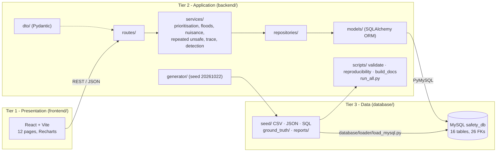

# Plant Safety Event Analytics

Finds **repeated unsafe conditions** in manufacturing plants by analysing safety alarms, machine states,
interlock states, operator acknowledgements, incidents and corrective actions.
Three-tier solution: **React (Vite)** → **FastAPI (Python)** → **MySQL 8**, on a fully synthetic, seeded and
reproducible dataset of **4 plants, 60 machines, 200 alarm definitions and 50,000 alarm events over 30 days**.

**Contents:** [1. Problem statement](#1-problem-statement) · [2. Our approach](#2-our-approach) ·
[3. Tables generated in the database](#3-tables-generated-in-the-database) · [4. Steps to run](#4-steps-to-run) ·
[5. Results](#5-results) · [6. Architecture](#6-architecture) · [7. Business rules](#7-business-rules) ·
[8. Documentation](#8-documentation)

---

## 1. Problem statement

**Business problem.** Analyse safety events, machine states, acknowledgements and corrective actions to find
**repeated unsafe conditions**.

**Actors.** Plant operator, maintenance / quality engineer, production planner, OT/IT administrator.

**What the solution must do**

| Area | Requirement |
|---|---|
| Entities | Plant, Machine, SafetyZone, Interlock, AlarmDefinition, AlarmEvent, OperatorShift, Acknowledgement, Incident, CorrectiveAction - PK for every entity, FK for every relationship, bridge tables for N:M, history for state changes |
| Workflow | Master data first → dependent events with valid parent IDs → safety zones / interlocks / severity / ack rules → state transitions and alarms with timestamps → operator shifts → incidents for unsafe combinations → ack and action timelines, preserving event order |
| IDs | `SAFE-<plant-id>-001`, `ALM-<machine-id>-000001`, `INC-2026-000001`, `ACK-<alarm-id>-01`, `ACT-<incident-id>-01` |
| Volume | 4 plants, 60 machines, 200 alarm definitions, 50,000 alarm events over 30 days, incl. alarm floods, delayed acknowledgements, nuisance alarms and genuine high-severity incidents |
| Edge cases | Acknowledgement before alarm · interlock state impossible · incident lacks triggering context · alarm flood duplicated by replay · action closed without verification |
| Data rules | Fixed seed, same generator for starter and full scale, derived values computed from source records, labelled anomalies in a **separate ground truth**, no label leakage |
| Validation | PK uniqueness, FK integrity, enums, date ordering, arithmetic reconciliation, lifecycle transitions, duplicates |
| Deliverables | CSV / JSON / SQL seed data, README, data dictionary, generator command, seed, source manifest, validation summary, reproducibility proof (regenerate twice, compare counts / checksums) |
| Acceptance | Timeline is coherent · severe alarms are prioritised · nuisance alarm clusters are identified · incident traceability includes machine state and action history |

---

## 2. Our approach

Each step of the problem statement mapped to what we built:

| # | PS step | What we did | Where |
|---|---|---|---|
| 1 | Data dictionary | Schema written once in `schema.sql`; a script generates the field-level dictionary (type, required, allowed values, units, uniqueness, FK, validation rule) from it, so docs never drift from the database | `database/schema/schema.sql`, `docs/DATA_DICTIONARY.md`, UI → Data Model |
| 2 | Master data first, then events | Generator builds plants → zones → machines (+ `machine_zone` bridge) → interlocks → alarm definitions → staff → shifts, then machine/interlock state timelines → alarms → acknowledgements → incidents → corrective actions | `backend/generator/master_data.py`, `events.py`, `incidents.py` |
| 3 | Domain logic | Machines walk a documented state machine for 30 days; guard-door / light-curtain trips stop running machines (E-stop); maintenance bypasses guards and sometimes forgets to remove the bypass; 5 "problem machines" repeat unsafe behaviour; alarms quieter at night; acknowledgements slower during floods and on night shift | `backend/generator/events.py`, `rules.py` |
| 4 | History, not overwrite | Every machine and interlock state change is a new row in an append-only event table; corrective actions keep all lifecycle timestamps | `machine_state_event`, `interlock_state_event`, `corrective_action` |
| 5 | Outcomes from rules, not random | Incidents are **derived** by rules R1–R3 applied to the generated data; response time, delayed flag, SLA and incident status are **computed** | `backend/generator/incidents.py`, `rules.py` |
| 6 | Deterministic IDs | All IDs built only by `id_factory.py`, zero-padded, immutable, identical across CSV / JSON / SQL | `backend/generator/id_factory.py` |
| 7 | Volume + coverage | Exactly 50,000 alarm events: 42 floods, 20 chattering bad actors, 903 safety-scenario alarms, delayed acks, 266 incidents | `backend/generator/run.py` |
| 8 | Labelled edge cases | Injected **after** the valid baseline; each one recorded in `ground_truth` (separate file and table, never an input column) | `backend/generator/anomalies.py`, `database/ground_truth/` |
| 9 | Validation | 80 checks in 7 groups; violations that are exactly the labelled edge cases are reported as EXPECTED, anything else is FAIL | `backend/scripts/validate.py` |
| 10 | Export + manifest | CSV + JSON per table, `seed.sql`, ground truth, `manifest.json` with row counts and SHA-256 of every file | `backend/generator/exporter.py`, `database/seed/`, `database/reports/` |
| 11 | Reproducibility | Generate twice with seed `20261022`, compare counts and checksums; identical on Windows and Linux | `backend/scripts/reproducibility.py` |
| 12 | Load to MySQL | Schema + bulk load parents-first with all FKs enforced, then verify row counts against the manifest | `database/loader/load_mysql.py` |
| 13 | Analytics (acceptance criteria) | Priority score (severe first), flood detection, nuisance / chatter detection, repeated-unsafe-condition detection, incident trace timeline | `backend/app/services/` |
| 14 | Measurable evaluation | Detectors use only operational data; ground truth is read only to score them (precision / recall / F1) | `backend/app/services/detection_service.py`, UI → Data Quality |
| 15 | Presentation | 12-page React UI incl. a live **PS checklist** (27/27), validation, reproducibility, data model and rules pages | `frontend/src/pages/` |
| 16 | One-command pipeline | `run_all.py`: generate → validate → reproduce → load MySQL → docs → tests → serve | `backend/run_all.py` |

### Labelled edge cases

| Edge case | Count | How it is injected | Detector (no ground truth used) | Expected decision |
|---|---:|---|---|---|
| Acknowledgement before alarm | 50 | ack_ts set 5–120 s before the alarm was raised | `response_sec < 0` | `REJECT_ACK_FLAG_CLOCK_SKEW` |
| Interlock state impossible | 30 | interlock TRIPPED recorded while the machine is RUNNING | trip with RUNNING snapshot | `FLAG_SENSOR_FAULT_QUARANTINE` |
| Incident lacks triggering context | 10 | no trigger alarm and no linked alarms | trigger null and no `incident_alarm` rows | `REQUIRE_CONTEXT_BEFORE_CLOSURE` |
| Alarm flood duplicated by replay | 500 | flood re-ingested hours later with the same PLC `source_seq` | duplicate `(machine, definition, source_seq)` | `DEDUPLICATE_EXCLUDE_FROM_KPIS` |
| Action closed without verification | 15 | status CLOSED with empty `verified_ts / verified_by` | lifecycle check | `REOPEN_ACTION_REQUIRE_VERIFICATION` |

Ground truth also labels the expected **patterns**: 42 alarm floods, 20 nuisance alarms, 19 repeated unsafe conditions.

---

## 3. Tables generated in the database

Database **`safety_db`** (MySQL 8, utf8mb4) - **16 tables, 26 foreign keys, 112,815 rows**, all created by
`database/schema/schema.sql` and loaded by `database/loader/load_mysql.py`.

| # | Table | Type | Rows | Primary key | Key relationships | Holds |
|---:|---|---|---:|---|---|---|
| 1 | `plant` | Master | 4 | `plant_id` (P01) | - | Manufacturing sites |
| 2 | `safety_zone` | Master | 20 | `zone_id` (SAFE-P01-001) | → plant | Hazard areas, hazard level 1–5, effective-dated |
| 3 | `machine` | Master | 60 | `machine_id` (P01-M001) | → plant | 6 machine types, criticality A/B/C |
| 4 | `machine_zone` | **Bridge N:M** | 76 | (`machine_id`, `zone_id`) | → machine, → safety_zone | One primary + optional secondary zone per machine |
| 5 | `interlock` | Master | 172 | `interlock_id` (ILK-P01-M001-01) | → machine, → safety_zone | Guard door, light curtain, E-stop, pressure |
| 6 | `alarm_definition` | Master | 200 | `alarm_def_id` (AD-0001) | - | Alarm catalogue: category, severity, ack SLA |
| 7 | `staff` | Master | 44 | `staff_id` (OP-P01-01 / QE-P01-01) | → plant | Operators and engineers (codes only) |
| 8 | `operator_shift` | Master | 364 | `shift_id` (SHF-P01-20261001-A) | → plant, → staff | Shifts A 06–14, B 14–22, C 22–06 |
| 9 | `machine_state_event` | History | 20,991 | `state_event_id` | → machine | Append-only machine state transitions |
| 10 | `interlock_state_event` | History | 1,813 | `interlock_event_id` | → interlock | Append-only interlock transitions + machine snapshot |
| 11 | `alarm_event` | Event | 50,000 | `alarm_event_id` (ALM-P01-M001-000001) | → machine, → alarm_definition, → operator_shift, → interlock (optional) | Raise / clear / receive time, PLC sequence, machine state at raise |
| 12 | `acknowledgement` | Event | 37,421 | `ack_id` (ACK-&lt;alarm-id&gt;-01) | → alarm_event (1 : 0..1), → operator_shift, → staff | Ack time and derived response seconds |
| 13 | `incident` | Event | 266 | `incident_id` (INC-2026-000001) | → machine, → safety_zone, → alarm_event (trigger, optional) | Rule-derived incidents and lifecycle status |
| 14 | `incident_alarm` | **Bridge N:M** | 307 | (`incident_id`, `alarm_event_id`) | → incident, → alarm_event | Trigger and context alarms per incident |
| 15 | `corrective_action` | Event | 391 | `action_id` (ACT-&lt;incident-id&gt;-01) | → incident, → staff (owner, verifier) | Actions with full lifecycle timestamps |
| 16 | `ground_truth` | Evaluation only | 686 | `gt_id` | - | Labels for injected anomalies and expected patterns (never used by detectors) |

Full field-level details: [docs/DATA_DICTIONARY.md](docs/DATA_DICTIONARY.md) · diagram: [docs/ERD.md](docs/ERD.md).

---

## 4. Steps to run

### Prerequisites
* Python 3.10+, Node.js 18+, MySQL 8 (or MariaDB 10.6+), Git
* VS Code (recommended) - open the project folder

### Step 1 - Clone
```powershell
git clone https://github.com/Saishiva-2003/plant-safety-event-analytics.git
cd plant-safety-event-analytics
```

### Step 2 - Create the database (MySQL Workbench or mysql client)
```sql
CREATE DATABASE safety_db CHARACTER SET utf8mb4 COLLATE utf8mb4_unicode_ci;
```

### Step 3 - Backend setup
```powershell
cd backend
python -m venv venv
.\venv\Scripts\Activate.ps1          # Linux/macOS: source venv/bin/activate
pip install -r requirements.txt
Copy-Item .env.example .env          # Linux/macOS: cp .env.example .env
```
Open `backend/.env` and set `DB_USER` and `DB_PASSWORD` to your MySQL login.

### Step 4 - Run the whole pipeline and start the API (one command)
```powershell
python run_all.py --serve
```
This generates the data (seed `20261022`), validates it (80 checks), proves reproducibility, **loads all 16 tables
into MySQL**, builds the docs, runs the 39 tests, and starts the API on http://localhost:8000. It prints a
`PIPELINE SUMMARY` and stops if validation or loading fails. Keep this terminal open.

Faster variant: `python run_all.py --skip-repro --skip-tests --serve`

<details>
<summary>Or run each step yourself</summary>

```powershell
python -m generator.run --scale full --seed 20261022   # -> database/seed, ground_truth, reports/manifest.json
python -m scripts.validate                             # -> reports/validation_summary.json
python -m scripts.reproducibility                      # -> reports/repro_report.json
python ..\database\loader\load_mysql.py                # schema + 112,815 rows into MySQL (Linux: ../database/...)
python -m scripts.build_docs                           # -> docs/*.md
pytest -q                                              # 39 tests
uvicorn app.main:app --reload --port 8000              # API
```
Small dataset for a quick try: `python -m generator.run --scale starter --out tmp_starter`
</details>

### Step 5 - Start the frontend (second terminal)
```powershell
cd frontend
npm install
npm run dev
```

### Step 6 - Open the app
* UI: **http://localhost:5173** - start with **PS Checklist** in the sidebar
* API docs (Swagger): http://localhost:8000/docs
* Health check: http://localhost:8000/api/health → `"alarm_events": 50000`

### Troubleshooting
| Symptom | Fix |
|---|---|
| UI shows "Backend not reachable" | Start the API (Step 4) |
| `503 DATABASE_UNAVAILABLE` | Start the MySQL service and check `backend/.env` |
| `npm error ... package.json` | Run npm commands inside `frontend/` |
| Port 8000 already in use | An API is already running - `run_all.py --serve` reuses it |
| `running scripts is disabled` (PowerShell) | `Set-ExecutionPolicy -Scope CurrentUser RemoteSigned` |

### Suggested 5-minute walkthrough
1. **PS Checklist** - every requirement with evidence and live status (27/27).
2. **Overview** - volumes, alarms per day (flood spikes), ack performance vs SLA, night shift slower.
3. **Alarm Explorer** - sorted by priority: CRITICAL bypass alarms in hazard-5 zones first.
4. **Repeated Unsafe** - escalation list; click an incident ID.
5. **Incident trace** (`INC-2026-000012`) - guard door bypassed → restart → CRITICAL alarm → ack → incident → actions; flags an action closed without verification.
6. **Floods & Nuisance**, **Data Quality** (precision / recall / F1), **Validation**, **Reproducibility**, **Data Model**, **Business Rules**.

---

## 5. Results

| What | Result |
|---|---|
| Dataset | 4 plants · 60 machines · 20 zones · 172 interlocks · 200 alarm definitions · **50,000 alarm events** · 20,991 machine-state events · 1,813 interlock events · 37,421 acknowledgements · 266 incidents · 391 corrective actions |
| Validation | **80 checks - 75 PASS, 5 EXPECTED (exactly the labelled edge cases), 0 FAIL** |
| Reproducibility | Two runs with seed `20261022` → identical counts and SHA-256 (combined `d40e71611fb01a97…`), same on Windows and Linux |
| Edge-case detection vs ground truth | All 5: precision 1.000 · recall 1.000 · **F1 1.000** |
| Pattern detection | Nuisance alarms F1 1.000 · Repeated unsafe conditions F1 1.000 · Alarm floods recall 1.000 / F1 0.933 |
| Repeated unsafe conditions | 19 (machine, rule) combinations on 16 machines - all 5 seeded "problem machines" found |
| Tests | **39 pytest tests** (generator, events, incidents, validation, reproducibility, API, error handling) |
| PS checklist (live in the UI) | **27 / 27 DONE** |

---

## 6. Architecture



Layering rule: **routes** only handle HTTP, **services** hold all business rules, **repositories** hold all SQL,
**models** map tables. The React app never talks to MySQL directly.

```
├── frontend/                  Tier 1 - React (Vite)
│   └── src/ api/ components/{layout,common,charts}/ pages/ hooks/ utils/ styles/
├── backend/                   Tier 2 - FastAPI + generator
│   ├── app/ core/ models/ dto/ repositories/ services/ routes/ main.py
│   ├── generator/             config, rules, id_factory, master_data, events, incidents, anomalies, exporter, run
│   ├── scripts/               validate, reproducibility, build_docs
│   ├── run_all.py             one-command pipeline
│   └── tests/                 39 tests
├── database/                  Tier 3 - MySQL
│   ├── schema/schema.sql      16 tables, PK / FK / CHECK / indexes
│   ├── loader/load_mysql.py   CSV -> MySQL bulk loader (verifies counts vs manifest)
│   ├── seed/{csv,json,sql}/   generated data
│   ├── ground_truth/          labels (separate, never a feature)
│   └── reports/               manifest.json, validation_summary.json, repro_report.json
└── docs/                      DATA_DICTIONARY, ERD, RULES, API, PROMPT_HISTORY
```

**Error handling.** Every API error returns `{"error": {"code", "message", "path", "details"}}`: 400 invalid
parameter combination, 404 unknown resource, 422 invalid value, 503 database unavailable, 500 unexpected (logged
server-side, no stack trace to the client). The UI shows these with a Retry button.

---

## 7. Business rules

Single source of truth: `backend/generator/rules.py` - the same rules create the data and analyse it.

* **Ack SLA:** CRITICAL 60 s · HIGH 300 s · MEDIUM 900 s · LOW 1800 s; delayed = response > SLA.
* **Priority** = severity weight (100/50/20/5) × zone hazard (1–5) × interlock factor (bypassed 2.0, tripped 1.5) + 2 × repeats in 24 h.
* **Incidents:** R1 critical safety alarm while an interlock is BYPASSED and the machine RUNNING · R2 guard / light-curtain
  alarm while RUNNING followed by E-stop within 60 s · R3 critical alarm unacknowledged > 300 s · manual near-miss reports.
* **Repeated unsafe condition:** same machine + same rule ≥ 3 times in a rolling 7 days.
* **Flood:** > 10 alarms in 10 min per plant · **Chatter:** ≥ 3 activations in 60 s · **Nuisance:** ≥ 5 chatter episodes.
* **Lifecycles:** incident OPEN → INVESTIGATING → ACTION_PENDING → CLOSED; action OPEN → IN_PROGRESS →
  PENDING_VERIFICATION → VERIFIED → CLOSED (closed only after verification).

Full list: [docs/RULES.md](docs/RULES.md).

---

## 8. Documentation

* [docs/DATA_DICTIONARY.md](docs/DATA_DICTIONARY.md) - every table and field: type, required, allowed values, units, uniqueness, FK, validation rule
* [docs/ERD.md](docs/ERD.md) - entity-relationship diagram and cardinality (1:N, 1:0..1, N:M bridges)
* [docs/RULES.md](docs/RULES.md) - business rules, state machines, lifecycles, expected decisions
* [docs/API.md](docs/API.md) - REST endpoints and the error format
* [docs/PROMPT_HISTORY.md](docs/PROMPT_HISTORY.md) - how the solution was built with an AI assistant, step by step

### Provenance and lawful use
**100 % synthetic data** produced by this generator. No external datasets, no personal or confidential information.
Plant names are generic placeholders; people are identified only by codes (`OP-P01-01`). Alarm-management thresholds
are inspired by the public concepts of ISA-18.2 (alarm management) and ISA-101 (HMI); no text or data from those
standards is reproduced.