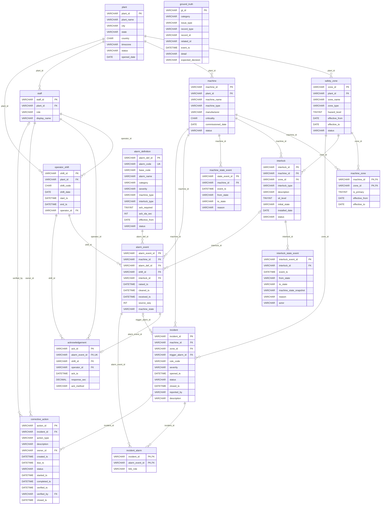

# Entity-Relationship Diagram

Generated from the foreign keys in `database/schema/schema.sql`. GitHub renders the Mermaid diagram below.

* `||--o{` one-to-many · `||--o|` one-to-zero-or-one · `|o--o{` optional parent
* Many-to-many relationships use bridge tables: **machine_zone** (machine ↔ safety_zone) and **incident_alarm** (incident ↔ alarm_event, role TRIGGER / CONTEXT)
* History tables (`machine_state_event`, `interlock_state_event`) are append-only - state is never overwritten

## Cardinality summary

| Parent | Cardinality | Child | Via |
|---|---|---|---|
| `plant` | **1:N** | `safety_zone` | `safety_zone.plant_id` |
| `plant` | **1:N** | `machine` | `machine.plant_id` |
| `machine` | **N:M** | `safety_zone` | `bridge machine_zone` |
| `machine` | **1:N** | `interlock` | `interlock.machine_id` |
| `safety_zone` | **1:N** | `interlock` | `interlock.zone_id` |
| `plant` | **1:N** | `staff` | `staff.plant_id` |
| `plant` | **1:N** | `operator_shift` | `operator_shift.plant_id` |
| `staff` | **1:N** | `operator_shift` | `operator_shift.operator_id` |
| `machine` | **1:N** | `machine_state_event` | `machine_state_event.machine_id` |
| `interlock` | **1:N** | `interlock_state_event` | `interlock_state_event.interlock_id` |
| `machine` | **1:N** | `alarm_event` | `alarm_event.machine_id` |
| `alarm_definition` | **1:N** | `alarm_event` | `alarm_event.alarm_def_id` |
| `operator_shift` | **1:N** | `alarm_event` | `alarm_event.shift_id` |
| `interlock` | **1:N (optional)** | `alarm_event` | `alarm_event.interlock_id` |
| `alarm_event` | **1:0..1** | `acknowledgement` | `acknowledgement.alarm_event_id (UNIQUE)` |
| `staff` | **1:N** | `acknowledgement` | `acknowledgement.operator_id` |
| `machine` | **1:N** | `incident` | `incident.machine_id` |
| `alarm_event` | **1:0..N (trigger, optional)** | `incident` | `incident.trigger_alarm_id` |
| `incident` | **N:M** | `alarm_event` | `bridge incident_alarm (TRIGGER / CONTEXT)` |
| `incident` | **1:N** | `corrective_action` | `corrective_action.incident_id` |
| `staff` | **1:N (owner, verifier)** | `corrective_action` | `corrective_action.owner_id / verified_by` |
